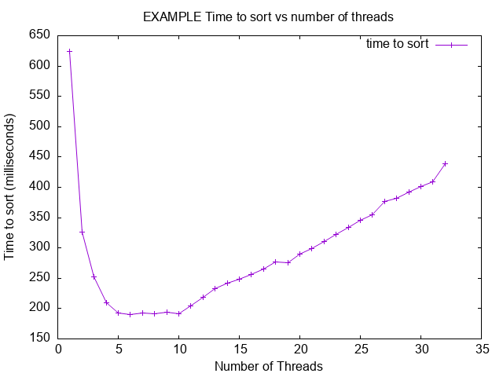

# Project 3

- Name: Zachary Johnston
- Email: <zacharyjohnston324@u.boisestate.edu>
- Class: C425-001

## Known Bugs or Issues

TODO: Are there any known issues?

## Experience

TODO: Describe your experience with the project (struggles, breakthroughs, etc.).

## AI Fixes Note

Note after lab 3 test implemented I reviewed what AI generated for the tests and I noticed it using memset(r.dev, 0, sizeof(r.dev) - 1) which doesn't entirely make sense for memory allocation. But at no point is the memory for the route struct allocated with a malloc in the make_route helper. This means the memory is allocated on the stack for the function which ends up being cleared when the helper function returns the memory is no longer guarenteed to exist. I changed the tester to instead using malloc and free to manage that memory.

Reference Diff in Fixing Memory Alloc in Tester for changes.

## Analysis

TODO: Provide your analysis of the results. If the assignment does not require
analysis, you can remove this section.

Here is an example of how to include a plot in your README:

